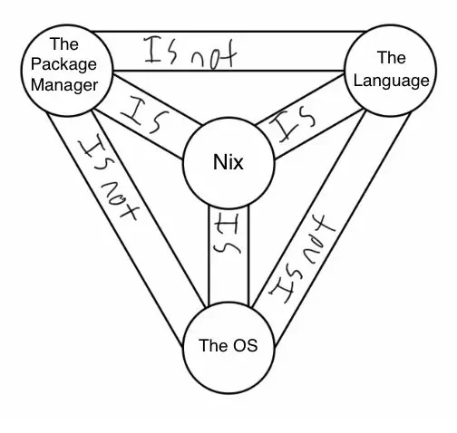

# What is Nix?
<!-- column_layout: [1, 1] -->
<!-- column: 0 -->

[Image Source: Andreas Fuchs](https://boinkor.net/2024/04/what-nix-will-have-been/)

<!-- column: 1 -->
Nix is:
- A package manager
- A language
- An operating system
- Poorly named

---

# A better question to ask
<!-- column_layout: [1, 2, 1] -->
<!-- column: 1 -->
<!-- pause -->
What can nix do?

---

# Project: link shortener
<!-- speaker_note: ensure `just dev` is running for the below curl commands to resolve -->
Simple web service with a connected database

```bash +exec
/// set -euo pipefail
# Create short link
code=$(curl -fsS http://127.0.0.1:8000/links \
  -H 'Content-Type: application/json' \
  -d '{"url":"https://nixos.org"}' | jq -er .code)
echo "Short link: http://127.0.0.1:8000/$code"

# Follow short link
curl -fsS -D - -o /dev/null "http://127.0.0.1:8000/$code" | grep Location

# Get short link hit count
curl -fsS "http://127.0.0.1:8000/$code/stats"
```

---

# Lets build a shell script!
<!-- pause -->
But shell scripts suck:
<!-- pause -->
- What runtime environment are you on?
- What version of `sed`, `curl` and dependencies do you have?
<!-- pause -->
- Do it wrong and your script is broken on a PDP 11 and a nerd on the internet yells at you

---

# Creating a shell script with nix

```nix
{ writeShellApplication, curl, jq }:
writeShellApplication {
  name = "shortctl";
  runtimeInputs = [ curl jq ];
  text = builtins.readFile ./shortctl.sh;
}
```
---

# Creating a shell script with nix

Evaluating this expression produces a "derivation" (package):

```bash +exec
nix build .#shortctl
nix eval .#shortctl --raw
```

---

# Installing the script (Demo)

---

# Lets build a developer environment!
<!-- pause -->
But dev environments suck:
<!-- pause -->
- Dev machines are mostly cruft
- Huge runbook of commands to get set up
- Then it breaks and takes forever to fix

---

# Dev environments

- Run ephemeral commands with `nix run` and `nix shell`
- Prepare and sync a full dev environment for your team
- Direnv gets a shoutout here

```nix
{ mkShell, go, gopls, postgresql, redis, process-compose, jq, just }:
mkShell {
  packages = [ go gopls postgresql redis process-compose jq just ];
  shellHook = ''
    export DATA_DIR=$PWD/.data
    export PGDATA=$DATA_DIR/postgres
    export PGHOST=$DATA_DIR
    export REDIS_SOCKET=$DATA_DIR/redis.sock
    export DATABASE_URL="postgresql:///postgres?host=$PGHOST"
    export REDIS_URL="unix://$REDIS_SOCKET"
  '';
}
```

---

# Dev environments

```bash +exec
nix build .#devShells.x86_64-linux.default
nix eval .#devShells.x86_64-linux.default --raw
```

---

# Lets deploy the app!
<!-- pause -->
But Deploying apps sucks:
<!-- pause -->
- Differences between prod & your laptop
- Dockers solution: Ship the laptop
- That can break too, if your deps change
- Isn't "reproducible"

---

# Packaging/Deploying the backend (Demo)

---
